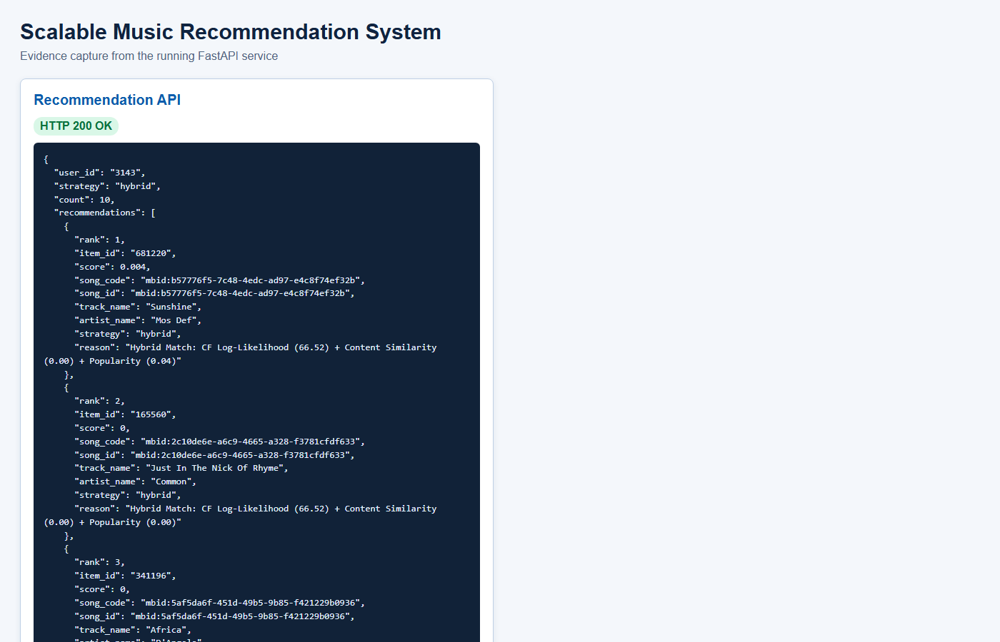

# Scalable Real-Time Music Recommendation System

> A Big Data recommendation platform that combines Apache Mahout, Apache Spark, Hadoop HDFS, MongoDB, FastAPI and an interactive music dashboard.

This project turns large-scale listening history into personalised song recommendations. It supports offline collaborative filtering, metadata-aware ranking, near-real-time listening events, distributed storage and evaluation through a reproducible Docker Compose environment.

## Project At A Glance

| Capability | Implementation |
| --- | --- |
| Personalised recommendations | Mahout item-based collaborative filtering |
| Hybrid ranking | Collaborative score + metadata similarity + popularity |
| Large-scale processing | Apache Spark batch and Structured Streaming |
| Distributed storage | Hadoop HDFS with three DataNode locations |
| Event persistence | MongoDB and JSON streaming input |
| Application API | FastAPI with automatic OpenAPI documentation |
| User interface | Streamlit dashboard and static music-focused frontend |
| Deployment | Docker Compose |
| Evaluation | Precision@K, Recall@K, MRR@K, MAP@K, NDCG@K and catalog coverage |

## Why This Project Matters

Music recommendation is an implicit-feedback problem: users usually do not rate songs directly, but their listening behaviour contains strong signals. A scalable recommender must combine those signals with catalogue information, handle users with limited history, process new events and return results quickly.

This project demonstrates that complete workflow rather than only a recommendation algorithm:

~~~text
Historical listening data
        -> distributed storage and processing
        -> collaborative filtering
        -> hybrid ranking service
        -> FastAPI
        -> interactive dashboard

New listening event
        -> FastAPI validation
        -> MongoDB and JSON event log
        -> Spark Structured Streaming
        -> Bronze / Silver / Gold analytics
~~~

## Architecture

~~~mermaid
flowchart LR
    D[Last.fm listening history] --> H[HDFS]
    H --> S[Spark batch processing]
    S --> M[Apache Mahout item-based CF]
    M --> O[Recommendation output]
    O --> R[Hybrid recommendation service]
    R --> A[FastAPI]
    A --> F[Dashboard]

    E[New listening event] --> A
    A --> V[Event validation]
    V --> DB[(MongoDB)]
    V --> J[JSON input directory]
    J --> SS[Spark Structured Streaming]
    SS --> L[Bronze / Silver / Gold]
    SS --> DB
~~~

### Offline recommendation path

1. Historical user-song interactions are prepared from the Last.fm 1K event log.
2. Spark can clean, aggregate and write the data into HDFS.
3. Mahout generates item-based collaborative filtering output using Log-Likelihood similarity.
4. The API reads the Mahout output and joins numeric IDs with song and user mappings.
5. The hybrid service enriches the collaborative result with metadata and popularity signals.

### Online and streaming path

1. The frontend or event producer sends a listening event to FastAPI.
2. FastAPI validates the user, song and event type.
3. The event is buffered for the live dashboard and written to MongoDB when available.
4. The same event is written as JSON input for Spark Structured Streaming.
5. Spark validates, transforms and aggregates the event through Bronze, Silver and Gold layers.

The system is near-real-time for event capture and monitoring. Model retraining remains an offline or periodic operation rather than retraining after every click.

## Recommendation Engine

The service lives in "backend/recommendation_service.py" and supports four complementary signals.

### Collaborative filtering

Apache Mahout produces item-based recommendations from implicit listening behaviour. If users frequently listen to two songs together, those songs receive a stronger relationship. The project uses "SIMILARITY_LOGLIKELIHOOD", which is appropriate for play counts rather than explicit star ratings.

### Content similarity

The API uses available catalogue metadata, including artist names and track-title tokens. It does not invent genre, mood or audio labels that are absent from the dataset.

### Behavioural co-occurrence

The service observes songs that appear together in user histories and uses that relationship to enrich recommendations and similar-song results.

### Popularity and cold start

Global listening activity provides a fallback for new users, users without Mahout output and sparse histories. This prevents an empty recommendation panel when personalised evidence is unavailable.

### Hybrid score

Scores are normalised before combination. The default ranking formula is:

~~~text
final_score = 0.7 * collaborative_score
            + 0.2 * content_or_cooccurrence_score
            + 0.1 * popularity_score
~~~

The weights can be changed through the API. They are configurable demonstration defaults, not claims of global optimality.

## Dataset

The active application catalogue is prepared from the Last.fm 1K dataset. It contains millions of listening events and real artist and track-name metadata.

| File | Purpose |
| --- | --- |
| "train_triplets.txt" | Aggregated user-song play counts |
| "song_mapping.csv" | Original track key to numeric item ID |
| "user_mapping.csv" | Original user key to numeric user ID |
| "song_metadata.csv" | Track, artist and catalogue statistics |
| "user_profiles.tsv" | Optional Last.fm user profile information |
| "mahout_input.csv" | Numeric input prepared for Mahout |

The raw dataset and generated catalogue files are intentionally excluded from Git because they are hundreds of megabytes to several gigabytes. The repository contains the preparation script and documents the expected paths.

### Prepare the Last.fm catalogue

Place the Last.fm source files in "dataset/lastfm-dataset-1K/", then run:

~~~powershell
python scripts/prepare_lastfm_dataset.py
~~~

The script streams the source file, aggregates repeated user-track events using SQLite, and writes the application-ready files into "dataset/lastfm/" without loading the complete raw event log into memory.

The repository also contains a one-million-row MSD benchmark arrangement. Keep its mappings and Mahout output paired separately from the Last.fm arrangement; do not mix their numeric IDs.

## Docker Services

"docker-compose.yml" defines the complete local Big Data topology.

| Service group | Role |
| --- | --- |
| FastAPI | Recommendation and event API |
| Streamlit | Python dashboard |
| MongoDB | Event and cached-document storage |
| "h-primary" | HDFS NameNode |
| "h-worker1" to "h-worker3" | HDFS DataNodes |
| YARN services | Resource management and worker execution |
| Spark master | Spark cluster coordinator |
| Spark workers | Distributed Spark executors |

The three DataNode containers demonstrate an HDFS replication factor of three. Docker containers are used for a local academic cluster simulation; a production deployment could place equivalent services on virtual machines, Kubernetes nodes or managed cloud services.

### Ports

| Service | Port | Purpose |
| --- | ---: | --- |
| FastAPI | "8000" | API and health checks |
| Streamlit | "8501" | Dashboard |
| MongoDB | "27017" | Database |
| HDFS NameNode UI | "9870" | HDFS inspection |
| YARN ResourceManager UI | "8088" | Job and resource inspection |
| Spark master | "7077" / "8081" | Cluster and web UI |

## Quick Start

### Docker Compose

~~~powershell
docker compose up -d --build
~~~

Then open:

- Dashboard: "http://localhost:8501"
- API documentation: "http://localhost:8000/docs"
- Health check: "http://localhost:8000/health"

Stop the stack with:

~~~powershell
docker compose down
~~~

### Local Python run

~~~powershell
python -m venv .venv
./.venv/Scripts/Activate.ps1
python -m pip install -r requirements.txt
python -m uvicorn backend.main:app --host 127.0.0.1 --port 8000
~~~

In another terminal:

~~~powershell
streamlit run streamlit_app.py --server.port 8501
~~~

The static frontend in "frontend/" can also be served separately for API-focused demonstrations.

## API Examples

~~~text
GET  /health
GET  /api/info
GET  /recommend/{user_id}?n=10&strategy=hybrid
GET  /similar/{song_id}?n=10
GET  /songs/{song_id}
GET  /user/{user_id}/history?limit=10
POST /events
GET  /live/events?limit=20
GET  /live/stats
GET  /evaluation/metrics
~~~

Example request:

~~~powershell
Invoke-RestMethod "http://localhost:8000/recommend/3143?n=10&strategy=hybrid"
~~~

The API returns readable track names and artist names alongside numeric IDs, recommendation scores, reasons, strategy and execution time.

## Streaming Demonstration

The event producer uses real mapped users and songs:

~~~powershell
python scripts/event_producer.py --count 20 --rate 2
~~~

Use "--skip-api" when testing only the JSON streaming input. The FastAPI simulator exposes equivalent controls through:

~~~text
GET  /live/stats
POST /live/simulator/start
POST /live/simulator/stop
~~~

The Spark streaming job reads "streaming/input", validates the schema, checkpoints progress and writes the medallion outputs.

## Evaluation

"GET /evaluation/metrics" evaluates the configured benchmark recommendation file with a deterministic train-only leave-one-item-out split. The active Docker profile uses the local train-only user/item-CF benchmark because it can be reproduced without requiring the Mahout container to be running; the production API still reads the Apache Mahout output from `MAHOUT_RECOMMENDATIONS_PATH`. The reported metrics include:

- Precision@K
- Recall@K
- Mean Reciprocal Rank
- Mean Average Precision
- Normalised Discounted Cumulative Gain
- Hit rate
- Catalogue coverage

The metrics are calculated from the available data and recommendation output; they are not manually hard-coded. To regenerate the benchmark artifact after changing the data or model logic:

~~~powershell
python scripts/build_local_cf_benchmark.py
~~~

The benchmark uses the top 100 interactions per user, removes one deterministic held-out item, and trains candidate generation from the remaining interactions. This avoids the previous first-million-row bias and makes Precision@10, Recall@10, MRR@10, and Hit Rate@10 directly reproducible.

## Evidence And Documentation

- [Architecture notes](docs/architecture.md)
- [Project readiness checklist](docs/project-readiness-checklist.md)
- [Case study report](Music_Recommendation_Big_Data_Case_Study_Report.docx)
- [Recommendation screenshot](screenshots/recommendation.png)
- [Streaming metrics screenshot](screenshots/streaming-metrics.png)
- [System health screenshot](screenshots/system-health.png)
- [Methodology diagram](report_assets/methodology_workflow.png)
- [Architecture diagram](report_assets/architecture_diagram.png)

## Testing

Run the Python tests with:

~~~powershell
python -m unittest discover -s tests -v
~~~

Validate the Compose file with:

~~~powershell
docker compose config --quiet
~~~

Infrastructure-level verification still requires starting Docker Desktop and checking the live Hadoop, YARN, Spark and MongoDB services together.

## Configuration

Copy ".env.example" to ".env" for local configuration. Keep ".env" private. Important variables include:

- "MAHOUT_RECOMMENDATIONS_PATH"
- "DATASET_INTERACTIONS_PATH"
- "SONG_MAPPING_PATH"
- "USER_MAPPING_PATH"
- "SONG_METADATA_PATH"
- "MONGO_URI"
- "STREAM_INPUT_DIR"
- "CORS_ORIGINS"

## Limitations And Future Work

Current limitations are intentional and documented:

- The recommendation model is retrained offline or periodically.
- Full Hadoop/Spark/MongoDB verification depends on local Docker resources.
- Java and a configured Mahout runtime are required to regenerate recommendation output.
- The active model uses listening behaviour and catalogue metadata, not raw audio embeddings.
- Raw licensed datasets are not redistributed in this repository.

Future extensions include continuous retraining, audio embeddings, mood classification, automated drift monitoring, A/B testing, user authentication, Kubernetes deployment and managed cloud storage.

## Academic Context

This repository is a college Big Data project demonstrating a complete recommendation-system workflow. The architecture is intentionally transparent: every stage from data preparation to API response can be inspected, tested and explained.

## License And Data Attribution

Application source code is provided for academic use. Dataset terms remain governed by the original Last.fm and Million Song Dataset terms. Do not redistribute the raw datasets without following their respective licences and attribution requirements.

